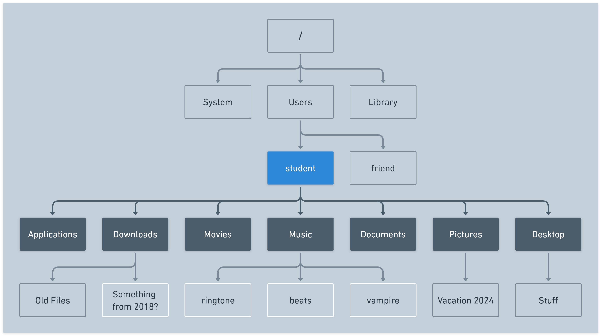

# Intro to the CLI - Navigating the file system


**Learning objective:** By the end of this lesson, students will be able to navigate the file system in the terminal.

## `pwd`

The `pwd` command prints the current (working) directory's path.

You'll recall from earlier that the `~` we see in the prompt on the command line is shorthand for the current user's home directory. This command will confirm that. Write and execute this command now:

```bash
pwd
```

tktk pwd screenshot

In the screenshot above, you can see that the directory we're in right now (`/Users/student`) is shown. Your device likely shows something different, and that's expected.

This is important. Just like when you have a location in a store when you're walking around it, we have a location in the file system when we're navigating it. This directory is just where we happen to start.

## `ls`

Let's take a look around with the `ls` command. This command lists the contents of the directory we are in. In other words:

- The directories inside this directory
- The files inside this directory

```bash
ls
```

tktk ls screenshot

A visual might help show what's happening here. Below the `student` directory (the user *home*) directory has been highlighted in blue. From this directory we're able to view its direct children, shown in dark gray, with the `ls` command. The other files and directories still exist, we just can't see them in this context. 



## cd

We can change the current directory with the `cd` command. This command works a little bit differently than the other ones we've learned so far because we need to supply the command with what is called a *command argument*. This is additional information we provide to the command to help it do its job. In this case we need to tell the `cd` command where we'd like to go.


> 📚 A *command argument* is an additional input provided to a command that provides it with necessary data to accomplish a task.
