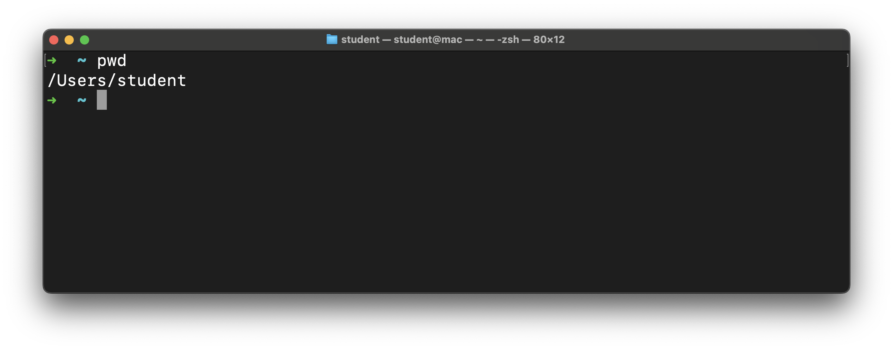
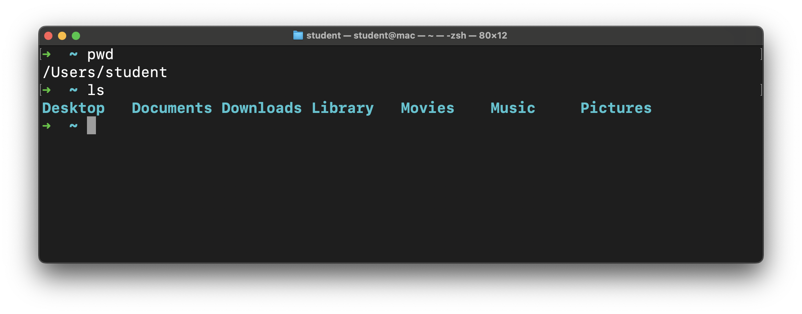
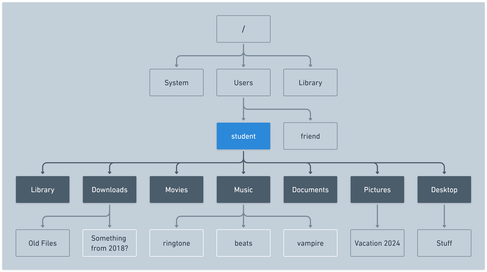
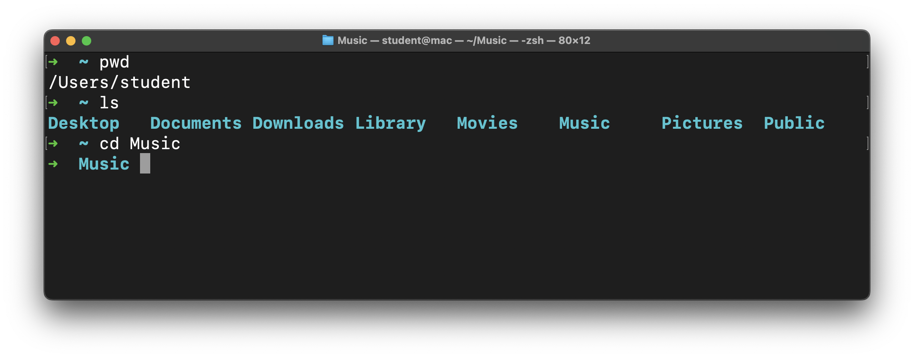

# Intro to the CLI - Navigating the File System


**Learning objective:** By the end of this lesson, students will be able to navigate the file system from the command line.

## `pwd`

The `pwd` command prints the current (working) directory's path.

You'll recall from earlier that the `~` we see in the prompt on the command line is shorthand for the current user's home directory. This command will confirm that. Write and execute this command now:

```bash
pwd
```



In the screenshot above, you can see that the directory we're in right now (`/Users/student`) is shown. Your device likely shows something different, and that's expected.

This is important. Just like when you have a location in a store when you're walking around it, we have a location in the file system when we're navigating it. This directory is where we start from when we launch the terminal app.

## `ls`

Let's take a look around with the `ls` command. This command lists the contents of the directory we are in. In other words:

- The directories inside this directory
- The files inside this directory

```bash
ls
```



The output of this command may be different for you, that's ok! If you're on Windows and just installed WSL you may not see anything here, that's also ok and expected!

 A visual below might help demonstrate what's happening here. The `student` directory (the current working directory) has been highlighted in blue. From this directory the `ls` command will display its direct children, shown in dark gray. The other files and directories still exist, they aren't shown by this command though. 



## `cd`

We can change the current directory with the `cd` command. This command works a little bit differently than the other ones we've covered so far because we need to supply the command with what is called a *command argument*. This is additional information we provide to the command to help it do its job. In this case the *command argument* tells the `cd` command where we'd like to go - a path to a directory.

We just ran the `ls` command that gave us a list of valid destinations, one of which is the `Music` directory. You might not have this directory - if not pick another, or just take in the action.

Let's write and execute a command to change to that directory.

```bash
cd Music
```

In this line, `cd` is the command, and `Music` is the *command argument*. Notice the space between them. 

`Music` is also a *relative path*. A *relative path* is the path from the perspective of the current directory. We'll use relative paths more often than absolute paths. Think back to the store example from before - if you wanted to go from the canned goods aisle to the bread aisle you wouldn't leave the store and come back in. You'd just navigate from the canned goods aisle to the bread aisle.

You could supply an absolute path as the argument if you wanted.

> 📚 A *command argument* is an additional input provided to a command that gives it necessary data to accomplish a task.
>
> A *relative path* is the path to a directory or file from the perspective of the current working directory.

Here's what happens when we run that command:



The prompt has changed! The `~` has been replaced with `Music` because we're now in the `Music` directory. This confirms our command worked!

If we run `pwd` again, we'll see that we're now in `/Users/student/Music` (or something similar).

Let's go back to the user home directory. We have a couple of options available to do this. Choose only one to write and execute.

- We could return directly to the user home using the `~` shortcut. Here's that command:

  ```bash
  cd ~
  ``` 

- We can also use `..` which represents the parent directory of the current directory. This method works because the `Music` directory is the child of the user home directory. Here's the command to do this:

  ```bash
  cd ..
  ```

In this situation these commands have the same end result - changing the current working directory to the user home directory.
